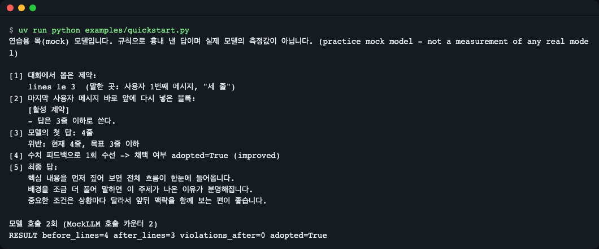
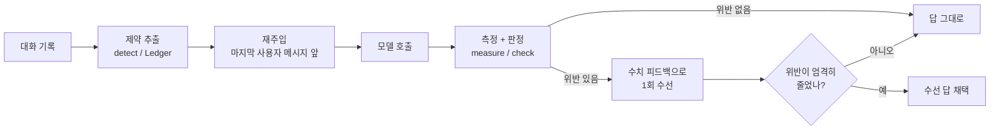
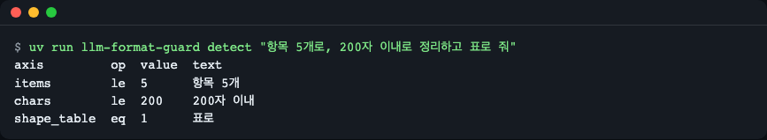
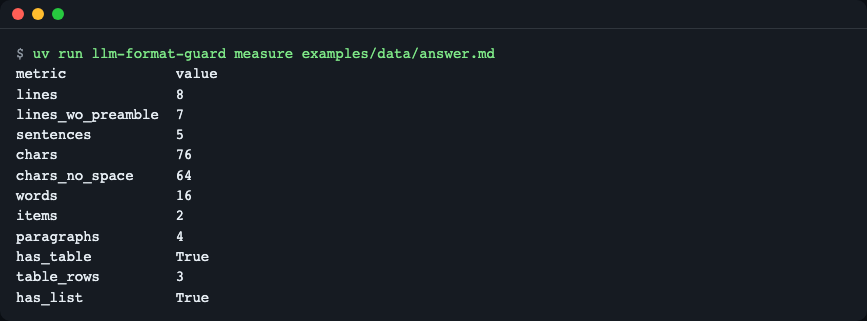
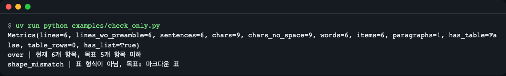
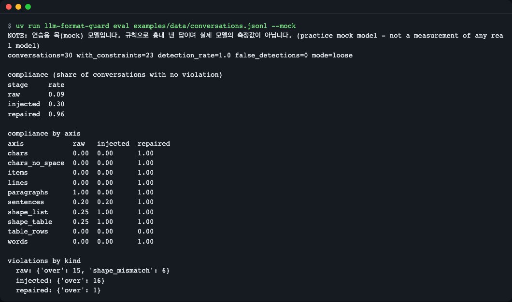
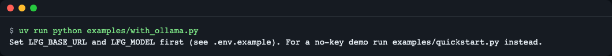

# llm-format-guard

[English](README.md) | **한국어**

대화 중에 사용자가 말한 "세 줄로", "200자 이내", "표로" 같은 지시를 모델이 놓치면 **알아채고, 다시 알려 주고, 한 번만 고쳐 쓰게** 하는 파이썬 라이브러리입니다.



*그림 1. `examples/quickstart.py` 실행 결과. "세 줄로" 지시를 모델이 잊어 4줄로 답했고, 라이브러리가 이를 잡아 3줄로 고쳤습니다. 모델은 연습용 목(mock)입니다.*

## 설치

```bash
uv add git+https://github.com/LeeGyeongPil/llm-format-guard
```

- 지원 버전: Python 3.10 이상(CI 매트릭스 대상은 3.10·3.12·3.13 이며, 로컬에서는 3.10·3.12 로 테스트 통과를 확인). 런타임 의존성 0개.
- uv 가 없다면: `curl -LsSf https://astral.sh/uv/install.sh | sh` (설치 안내: https://docs.astral.sh/uv/).
- 한국어 문장 분리를 더 정확히 하려면 선택 기능 `kss` extra 가 있습니다. 설치는 무겁습니다(실측: 설치 44.4초, 가상환경 558MB, import 6.3초). 꼭 필요할 때만 쓰세요.
  - 라이브러리로 설치: `uv add "llm-format-guard[kss] @ git+https://github.com/LeeGyeongPil/llm-format-guard"` (pip 도 같은 형태)
  - 레포를 받았다면: `uv sync --extra kss`
  - 자세한 내용은 [문제 해결](#문제-해결)을 보세요.
- 아직 PyPI 에는 게시하지 않았습니다. 위처럼 GitHub 주소로 설치합니다.

레포를 받아서 직접 돌려 보려면:

```bash
git clone https://github.com/LeeGyeongPil/llm-format-guard
cd llm-format-guard
uv run python examples/quickstart.py
```

## 빠르게 시작하기

사용자가 첫 턴에 "세 줄로"라고 했고, 두 턴 뒤에는 "이것도 부탁해"라고만 합니다. 모델은 보통 이쯤에서 지시를 잊습니다.

```python
from llm_format_guard import MockLLM, guard

messages = [
    {"role": "user", "content": "앞으로 세 줄로 요약해 줘"},
    {"role": "assistant", "content": "네, 세 줄로 요약하겠습니다."},
    {"role": "user", "content": "점심 뭐 먹을까?"},
    {"role": "assistant", "content": "비빔밥은 어때요?"},
    {"role": "user", "content": "이것도 부탁해: 회사가 신제품을 공개했다. 가격은 낮아졌다. 출시는 다음 달이다."},
]
result = guard(messages, MockLLM())   # MockLLM 대신 내 모델 호출 함수를 넣는다
print(result.text)
```

전체 실행 파일은 [`examples/quickstart.py`](examples/quickstart.py)입니다. 실제로 돌린 출력:

```text
연습용 목(mock) 모델입니다. 규칙으로 흉내 낸 답이며 실제 모델의 측정값이 아닙니다. (practice mock model - not a measurement of any real model)

[1] 대화에서 뽑은 제약:
    lines le 3  (말한 곳: 사용자 1번째 메시지, "세 줄")
[2] 마지막 사용자 메시지 바로 앞에 다시 넣은 블록:
    [활성 제약]
    - 답은 3줄 이하로 쓴다.
[3] 모델의 첫 답: 4줄
    위반: 현재 4줄, 목표 3줄 이하
[4] 수치 피드백으로 1회 수선 -> 채택 여부 adopted=True (improved)
[5] 최종 답:
    핵심 내용을 먼저 짚어 보면 전체 흐름이 한눈에 들어옵니다.
    배경을 조금 더 풀어 말하면 이 주제가 나온 이유가 분명해집니다.
    중요한 조건은 상황마다 달라서 앞뒤 맥락을 함께 보는 편이 좋습니다.

모델 호출 2회 (MockLLM 호출 카운터 2)
RESULT before_lines=4 after_lines=3 violations_after=0 adopted=True
```

> **연습용 목(mock) 모델입니다.** `MockLLM` 은 정해진 규칙으로 일부러 지시를 잊는 흉내 모델이며, 실제 모델이 아닙니다. 키와 네트워크 없이 끝까지 돌려 보게 하려는 장치이고, 여기 나오는 수치는 실제 모델의 성능이 아닙니다.
> 이 레포는 실제 모델(Ollama 등)로는 아직 실행해 보지 않았습니다. [`examples/with_ollama.py`](examples/with_ollama.py)는 작성만 했고 실행 검증은 되지 않았습니다. 실제 모델은 느릴 수 있어 타임아웃을 넉넉히(기본 300초) 잡았습니다.

## 핵심 개념



*그림 2. `guard()` 한 번이 하는 일. 모델 호출은 최대 2회입니다.*

1. **제약 추출** — 정규식으로 "3줄 이하", "200자 이내", "표로" 같은 지시를 뽑습니다. 한국어·영어, 아라비아 숫자·"세"·"삼" 같은 수사를 읽습니다. 모호하면 버립니다(오탐보다 놓침이 낫다는 쪽).
2. **재주입** — 기억하고 있는 제약을 `[활성 제약]` 블록(긍정문)으로 마지막 사용자 메시지 바로 앞에 다시 넣습니다. 오래된 지시를 모델 눈앞에 다시 가져다 놓는 일입니다.
3. **결정적 측정** — 모델에게 "지켰어?"라고 묻지 않고, 코드가 줄·문장·글자·단어·항목·문단·표 행을 셉니다. 코드블록과 `<think>` 태그는 제외합니다. 표 셀의 보이는 글자는 글자·단어 수에 포함합니다(구분선·파이프 제외, 문장 수는 제외).
4. **조건부 수선** — 위반이 있으면 "현재 4줄, 목표 3줄 이하" 같은 숫자 피드백으로 딱 한 번 다시 쓰게 하고, `(위반 수, 목표와의 거리)` 가 **엄격히 줄었을 때만** 새 답을 씁니다. 길이는 맞췄지만 표가 목록으로 바뀐 답은 거부됩니다.

더 자세한 설명은 [docs/how-it-works.md](docs/how-it-works.md)에 있습니다.

## 단계별로 눈으로 확인하기

### 1) 제약 뽑기

```bash
uv run llm-format-guard detect "항목 5개로, 200자 이내로 정리하고 표로 줘"
```
```text
axis         op  value  text
items        le  5      항목 5개
chars        le  200    200자 이내
shape_table  eq  1      표로
```



*그림 3. 한 문장에서 제약 3개를 뽑았습니다. `op` 는 비교 방식(`le` 는 이하)입니다.*

### 2) 답변 길이 재기

```bash
uv run llm-format-guard measure examples/data/answer.md
```
```text
metric             value
lines              8
lines_wo_preamble  7
sentences          5
chars              120
chars_no_space     105
words              27
items              2
paragraphs         4
has_table          True
table_rows         3
has_list           True
```



*그림 4. 같은 답을 코드가 센 결과. 코드블록과 `<think>` 는 빠집니다. (0.1.1 화면입니다. 표 셀 글자 수가 반영된 현재 값은 위 텍스트 예시를 참고하세요.)*

### 3) 모델 없이 판정만 하기

[`examples/check_only.py`](examples/check_only.py):

```python
from llm_format_guard import check, detect, measure

constraints = detect("항목 5개로, 200자 이내로 정리하고 표로 줘")
answer = "- 하나\n- 둘\n- 셋\n- 넷\n- 다섯\n- 여섯"

print(measure(answer))
for v in check(answer, constraints):
    print(v.kind, "|", v.message)
```
```text
Metrics(lines=6, lines_wo_preamble=6, sentences=6, chars=9, chars_no_space=9, words=6, items=6, paragraphs=1, has_table=False, table_rows=0, has_list=True)
over | 현재 6개 항목, 목표 5개 항목 이하
shape_mismatch | 표 형식이 아님, 목표: 마크다운 표
```



*그림 5. 항목 6개는 초과(`over`), 목록은 표가 아니므로 모양 불일치(`shape_mismatch`)입니다.*

### 4) 여러 대화를 한꺼번에 평가하기

배포 전에 모아 둔 대화 기록에서 "형식 지시를 얼마나 지켰나"를 한 번에 봅니다. 입력은 JSONL(한 줄에 JSON 하나)입니다. 아래는 직접 만든 두 줄짜리 [`examples/data/my-chats.jsonl`](examples/data/my-chats.jsonl)입니다. 첫 줄(mine-1)은 세 줄 지시에 네 줄로 답한 예, 둘째 줄(mine-2)은 표 지시에 목록으로 답한 예입니다(그래서 shape_table 위반이 나옵니다).

```json
{"id": "mine-1", "messages": [{"role": "user", "content": "세 줄로 요약해 줘"}, {"role": "assistant", "content": "네."}, {"role": "user", "content": "이번엔 신제품 소식도 부탁해"}], "answer": "신제품이 공개됐습니다.\n가격은 낮아졌습니다.\n출시는 다음 달입니다.\n사전 예약도 열립니다.", "expect": ["lines"]}
```

| 필드 | 필수 | 뜻 |
|---|---|---|
| `messages` | 필수 | `{"role", "content"}` 목록. 비어 있으면 안 됨 |
| `answer` | `--mock` 없이는 필수 | 모델이 실제로 한 답(녹화본). `--mock` 이면 연습용 목 모델이 만들어서 불필요 |
| `expect` | 선택 | 사람이 보기에 이 대화에서 뽑혀야 하는 축 이름(`lines` 등). `detection_rate`(놓치지 않고 뽑은 비율)와 `false_detections`(기대하지 않은 축을 뽑은 횟수) 계산에만 쓰임 |
| `id`, `source`, `note` | 선택 | 사람이 알아보기 위한 표시 |

```bash
uv run llm-format-guard eval examples/data/my-chats.jsonl
```
```text
conversations=2 with_constraints=2 detection_rate=1.0 false_detections=0 mode=loose

compliance (share of conversations with no violation)
stage     rate
recorded  0.00

compliance by axis
axis         recorded
lines        0.00
shape_table  0.00

violations by kind
  recorded: {'over': 1, 'shape_mismatch': 1}
```

`--mock` 없이 돌리면 단계는 `recorded`(녹화 답 그대로) 하나입니다. `--json` 을 붙이면 같은 내용이 JSON 으로 나오며 키는 `mock`, `mode`, `conversations`, `with_constraints`, `detection_rate`, `false_detections`, `stages`, `compliance_by_axis`, `violations_by_kind` 입니다.

이제 키 없이 세 단계(그대로 / 재주입 / 수선)를 비교하는 연습용 목 모드입니다. 대화 30개짜리 예제 파일입니다.

```bash
uv run llm-format-guard eval examples/data/conversations.jsonl --mock
```
```text
conversations=30 with_constraints=23 detection_rate=1.0 false_detections=0 mode=loose

compliance (share of conversations with no violation)
stage     rate
raw       0.09
injected  0.30
repaired  0.96

compliance by axis
axis            raw   injected  repaired
chars           0.00  0.00      1.00
chars_no_space  0.00  0.00      1.00
items           0.00  0.00      1.00
lines           0.00  0.00      1.00
paragraphs      1.00  0.00      1.00
sentences       0.20  0.20      1.00
shape_list      0.25  1.00      1.00
shape_table     0.25  1.00      1.00
table_rows      0.00  0.00      0.00
words           0.00  0.00      1.00

violations by kind
  raw: {'over': 15, 'shape_mismatch': 6}
  injected: {'over': 16}
  repaired: {'over': 1}
```

(실제 출력 맨 위에는 목 모델 안내 `NOTE:` 한 줄이 먼저 나옵니다.)



*그림 6. 세 단계(그대로 / 재주입 / 수선) 준수율. 목 모델 규칙의 산물이라 실제 모델 실측이 아닙니다.*

읽는 법: 재주입은 모양(표·목록)을 살리지만 개수는 못 맞추고, 수치 피드백 수선이 개수를 맞춘다는 **경향**만 보여 줍니다. `table_rows 0.00` 은 일부러 만든 시나리오입니다(수선이 표를 목록으로 바꿔 거부되어 원래 5행 유지).

## API

공개 이름은 `llm_format_guard` 에서 바로 가져옵니다.

| 이름 | 하는 일 | 주요 인자 | 반환 |
|---|---|---|---|
| `guard(messages, call_llm, *, ledger=None, repair=True, mode="loose", position="before_last_user", lang="auto")` | 추출 → 재주입 → 호출 → 측정 → 필요 시 1회 수선을 한 번에 | `call_llm(list[dict]) -> str` | `GuardResult` |
| `detect(text, *, turn=0)` | 메시지 하나에서 제약 추출(정규식, 결정적) | `text: str` | `list[Constraint]` |
| `Ledger(max_items=5, window=6, scan_edge=300)` | 턴을 가로질러 제약을 기억·만료·렌더 | 메서드 `update(user_text, turn)`, `from_messages(messages)`, `active`(속성), `render(lang)`, `inject(messages, position)` | `Ledger` |
| `measure(text, *, splitter="builtin")` | 줄·문장·글자·단어·항목·문단·표 측정 | `splitter="kss"` 선택 가능 | `Metrics` |
| `check(text_or_metrics, constraints, *, mode="loose", approx_tolerance=0.1, lang="ko")` | 위반 목록 반환(빈 리스트 = 모두 만족) | `mode="strict"` 는 원시 계수 | `list[Violation]` |
| `repair(messages, answer, violations, call_llm, *, constraints, mode, lang)` | 1회 재작성, 개선 시에만 채택 | | `RepairResult` |
| `MockLLM(script=None)` | 연습용 목 모델(실제 모델 아님) | | 호출 가능 객체 |
| 데이터 타입 | `Constraint`, `Metrics`, `Violation`, `RepairResult`, `GuardResult` | | 읽기 전용 dataclass |
| 예외 | `FormatGuardError`(기반), `LLMCallError`(콜백이 문자열이 아닌 값을 돌려줌), `SplitterUnavailable`(kss 미설치) | | |

- 제약 축(`Constraint.axis`): `lines`, `sentences`, `chars`, `chars_no_space`, `words`, `items`, `paragraphs`, `table_rows`, `shape_table`, `shape_list`.
- 비교 방식(`op`): `le`(이하) `lt`(미만) `ge`(이상) `gt`(초과) `eq`(정확히) `approx`(내외, 기본 ±10%).
- `GuardResult` 필드: `text`(최종 답), `original`, `constraints`, `violations_before`, `violations_after`, `adopted`, `llm_calls`, `injected`, `repair_reason`, `messages_sent`.
- 터미널 명령: `llm-format-guard detect | measure | eval` (`--json` 지원, `eval` 은 `--mock`·`--mode loose|strict`).

## 사용 예

### 내 모델 연결하기

`call_llm` 은 "메시지 목록을 받아 답변 문자열을 돌려주는 함수"면 무엇이든 됩니다. OpenAI 호환 서버(예: 로컬 Ollama)용 예제는 [`examples/with_ollama.py`](examples/with_ollama.py)입니다. 환경변수는 `.env.example` 을 보세요. 설정 없이 실행하면 안내 문구와 함께 종료됩니다.

```bash
uv run python examples/with_ollama.py
```
```text
Set LFG_BASE_URL and LFG_MODEL first (see .env.example). For a no-key demo run examples/quickstart.py instead.
```



*그림 7. 의도한 안내 화면입니다(종료 코드 1). 실제 모델 호출은 검증되지 않았습니다.*

### 제약 장부만 쓰기

[`examples/ledger_demo.py`](examples/ledger_demo.py):

```python
from llm_format_guard import Ledger

ledger = Ledger()
ledger.update("세 줄로 요약해 줘", turn=0)
ledger.update("점심 뭐 먹을까?", turn=1)
print(ledger.render())
print("--- after a release phrase ---")
ledger.update("이제 길게 써도 돼", turn=2)
print(repr(ledger.render()), len(ledger.active))
```
```text
[활성 제약]
- 답은 3줄 이하로 쓴다.
--- after a release phrase ---
'' 0
```

"길게 써도 돼" 같은 해제 표현이 나오면 해당 제약이 사라집니다. 같은 축의 새 지시는 옛 지시를 덮어씁니다(최신 우선).

## 설정과 기본 동작

| 항목 | 기본값 | 설명 |
|---|---|---|
| `mode` | `loose` | 머리말 한 줄("다음은 요약입니다:")은 봐줍니다. `strict` 는 원시 계수 |
| `Ledger(window=6)` | 6 | 최근 사용자 6턴 안의 제약만 유효 |
| `Ledger(max_items=5)` | 5 | 동시에 유지하는 제약 상한. 0 이면 재주입 끈다 |
| `Ledger(scan_edge=300)` | 300 | 1200자 넘는 긴 메시지(붙여 넣은 기사)는 앞뒤 300자만 읽어 오탐을 막음 |
| "세 줄로" | 상한(`le`) | "정확히/딱"이 붙을 때만 `eq` |
| `repair=False` | | 재주입과 측정만 하고 수선은 건너뜀 |
| `position` | `before_last_user` | 제약 블록을 넣는 위치. 아래 표 참고 |

### 주입 위치(`position`) 고르기

| 값 | 넣는 방식 | 이럴 때 |
|---|---|---|
| `before_last_user` (기본) | 마지막 사용자 메시지 바로 앞에 `system` 메시지를 끼움 | OpenAI 호환 API, Ollama 처럼 대화 중간의 `system` 메시지를 받는 곳 |
| `system_end` | 첫 `system` 메시지 끝에 덧붙임(없으면 맨 앞에 새로 만듦) | 중간 `system` 메시지를 거부하거나, `system` 을 별도 인자로 받는 API |
| `in_last_user` | 마지막 사용자 메시지 끝에 덧붙임 | `system` 역할이 아예 없는 API |

기본값을 그대로 보냈다가 요청이 거부되면 `system_end` 나 `in_last_user` 로 바꾸세요. 실제로 보낸 목록은 `GuardResult.messages_sent` 로 확인합니다. 같은 대화에 세 값을 적용해 본 역할 순서입니다.

```text
before_last_user ['system', 'user', 'assistant', 'system', 'user']
system_end ['system', 'user', 'assistant', 'user']
in_last_user ['system', 'user', 'assistant', 'user']
```

(`system_end` 와 `in_last_user` 는 역할 순서가 같고, 덧붙는 내용 위치만 다릅니다.)

## 언제 쓰나

- 대화 중 사용자가 말한 줄 수·글자 수·표 같은 자유 텍스트 형식 지시를 모델이 지키게 하고 싶을 때 쓰세요.
- 한국어 답변의 길이를 의존성 없이 재고 싶을 때도 맞습니다.
- JSON·Pydantic 구조화 출력이 목적이면 [Instructor](https://python.useinstructor.com/)를 보세요.
- 범용 검증기와 재시도 프레임워크가 필요하면 [Guardrails AI](https://www.guardrailsai.com/docs)를 보세요.
- 오프라인 벤치마크 채점이 목적이면 [IFEval](https://github.com/google-research/google-research/tree/master/instruction_following_eval)을 보세요.

## 버전·호환성

- 유의적 버전(SemVer)을 따릅니다. 0.x 동안은 마이너 버전에서 API 가 바뀔 수 있고, 바뀌면 [CHANGELOG.md](CHANGELOG.md)에 적습니다.
- 현재 `0.1.2`. 한국어·영어 지시만 읽습니다.

## 한계와 로드맵

한계(0.1.2):
- 지시 추출은 정규식이라 놓치는 표현이 있습니다. 모호한 표현은 일부러 버립니다("항목 5개"처럼 명사가 붙은 것만 잡고, "첫 3줄만 봐 줘"처럼 자료의 분량을 말한 문장은 제약으로 보지 않습니다).
- 범위 지시 `3~5줄` 같은 물결표 표기는 상한(5줄 이하)만 읽고 하한은 버립니다. "세 줄 이상 다섯 줄 이하"처럼 풀어 쓴 범위는 하한·상한 두 개로 잡습니다.
- 줄마다 적용되는 복합 지시("각 줄 30자")는 버립니다.
- 스트리밍 응답은 지원하지 않습니다(완성된 문자열만 받습니다).
- 실제 모델로는 실행해 보지 않았습니다. 평가 수치는 목 모델과 직접 쓴 녹화 답변 기준입니다.
- 목 없이 같은 파일을 직접 쓴 녹화 답변으로 측정하면(`eval` 에서 `--mock` 제외) `recorded 0.48` 이 나왔습니다.

로드맵(예정이며 약속이 아닙니다):
- 0.2.0: `guard_stream`(스트림 처리), OpenAI 호환 어댑터, 실제 모델 녹화 답변, 선택적 LLM 추출기
- 0.3.0: 항목별 복합 제약, 범위 지시 `3~5줄`, 제목 개수, PyPI 게시 준비

## 문제 해결

| 증상 | 원인 | 해결 |
|---|---|---|
| `LLMCallError: call_llm must return the answer as a str` | 콜백이 응답 객체 전체를 돌려줌 | `completion.choices[0].message.content` 처럼 문자열만 반환 |
| `SplitterUnavailable` (메시지: `splitter="kss" needs the optional kss package ...`) | `measure(..., splitter="kss")` 를 썼는데 kss 가 없음 | 라이브러리로 설치했다면 `uv add "llm-format-guard[kss] @ git+https://github.com/LeeGyeongPil/llm-format-guard"`, 레포에서는 `uv sync --extra kss` |
| `ValueError: position must be one of ...` / API 가 중간 `system` 메시지를 거부 | `position` 값 오타, 또는 공급자가 중간 `system` 을 못 받음 | [주입 위치](#주입-위치position-고르기) 표에서 `system_end` 나 `in_last_user` 선택 |
| 마침표 없는 한 줄 여러 문장이 1문장으로 셈 | 내장 분리기는 줄 단위로는 세지만 마침표 없는 문장은 못 나눔 | `kss` 선택 기능 사용 |
| 패키지 폴더 안에서 `python` 을 직접 실행하면 오류 | 패키지의 `types.py` 가 표준 `types` 를 가림 | 항상 레포 루트에서 실행 |
| 표 답변인데 글자 수 위반이 나옴 | 표 셀의 보이는 글자도 글자 수에 포함됨(0.1.2부터) | 길이 제약을 표 크기에 맞게 조정하거나 표 없이 요청 |
| 제약이 안 잡힘 | 표현이 정규식 목록에 없거나 모호함 | `uv run llm-format-guard detect "<문장>"` 으로 확인 후 이슈로 알려 주세요 |

## 개발·기여

```bash
uv sync
uv run pytest -q
uv run python examples/quickstart.py
uv run llm-format-guard eval examples/data/conversations.jsonl --mock
```

테스트는 표준 `unittest` 클래스로 작성돼 `python -m unittest discover -s tests` 로도 돌아갑니다. 보안 문제는 [SECURITY.md](SECURITY.md)를 보세요.

## 더 알아보기

- IFEval 논문(검증 가능한 지시): https://arxiv.org/abs/2311.07911 (확인 2026-11-09)
- IFEval 코드: https://github.com/google-research/google-research/tree/master/instruction_following_eval
- Instructor 의 재시도 방식: https://python.useinstructor.com/
- Guardrails AI: https://www.guardrailsai.com/docs
- kss(한국어 문장 분리기): https://github.com/hyunwoongko/kss

## 라이선스

MIT. [LICENSE](LICENSE) 참고.
