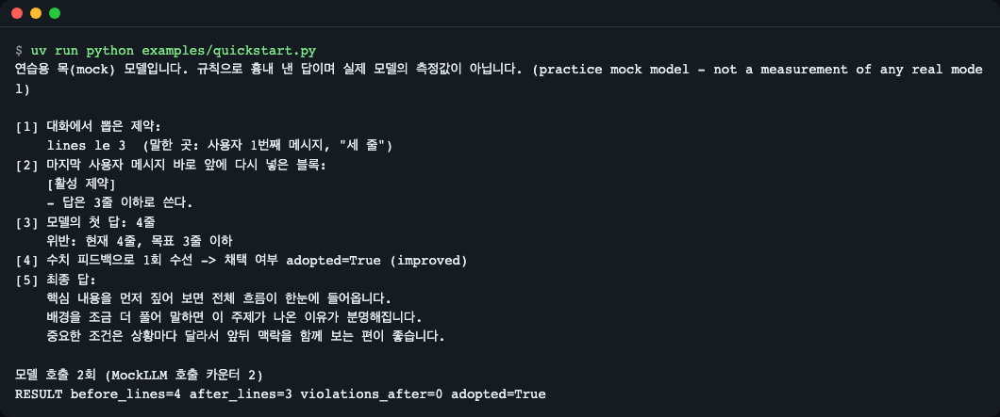
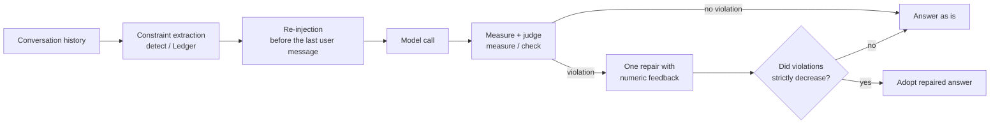
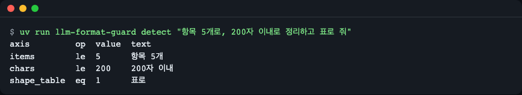
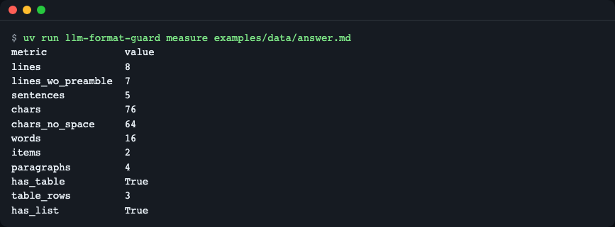
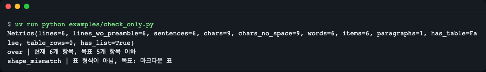
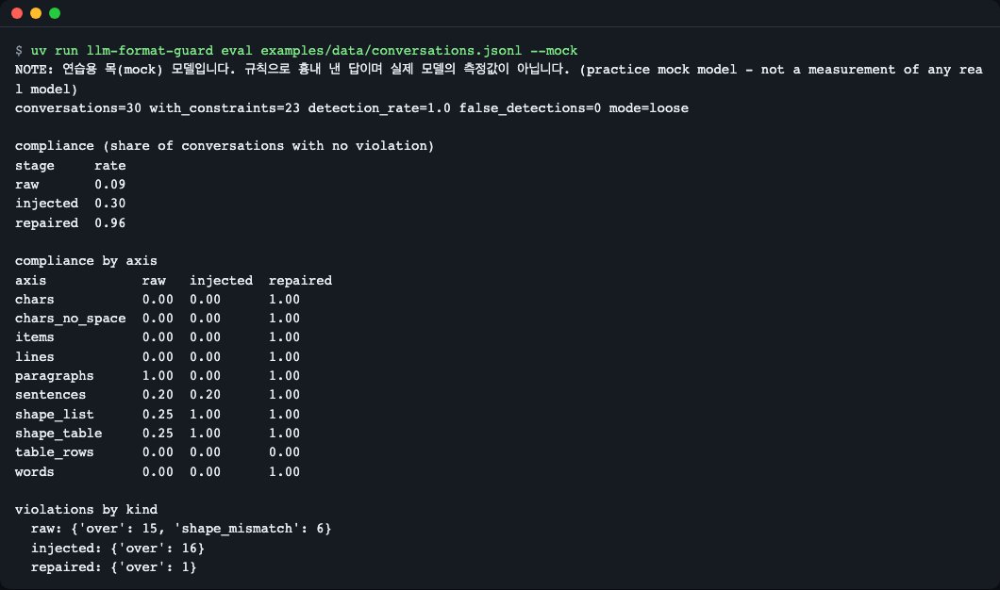
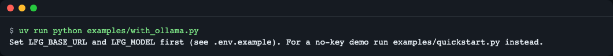

# llm-format-guard

**English** | [한국어](README.ko.md)

A small Python library that catches LLM answers which ignore the user's format and length instructions ("in three lines", "within 200 characters", "as a table") during a conversation. It extracts the constraints from the chat, re-injects them before the last user message, measures the answer deterministically (Korean and markdown aware), and asks the model to rewrite the answer exactly once, adopting the rewrite only when it is strictly better. Zero runtime dependencies, Python 3.10+. Install: `uv add git+https://github.com/LeeGyeongPil/llm-format-guard`.



*Figure 1. Output of `examples/quickstart.py`. The model forgot the "in three lines" instruction and answered in 4 lines; the library caught it and fixed it to 3 lines. The model is a practice mock.*

## Installation

```bash
uv add git+https://github.com/LeeGyeongPil/llm-format-guard
```

- Supported versions: Python 3.10 or later (the CI matrix targets 3.10, 3.12 and 3.13; locally, passing tests were confirmed on 3.10 and 3.12). Zero runtime dependencies.
- If you do not have uv: `curl -LsSf https://astral.sh/uv/install.sh | sh` (installation guide: https://docs.astral.sh/uv/).
- For more accurate Korean sentence splitting there is an optional `kss` extra. Installation is heavy (measured: 44.4 s to install, 558 MB virtual environment, 6.3 s to import). Use it only when you really need it.
  - Install as a library: `uv add "llm-format-guard[kss] @ git+https://github.com/LeeGyeongPil/llm-format-guard"` (pip uses the same form)
  - If you cloned the repo: `uv sync --extra kss`
  - See [Troubleshooting](#troubleshooting) for details.
- It has not been published to PyPI yet. Install from the GitHub address as shown above.

To clone the repo and run it yourself:

```bash
git clone https://github.com/LeeGyeongPil/llm-format-guard
cd llm-format-guard
uv run python examples/quickstart.py
```

## Quick start

On the first turn the user says "세 줄로" (in three lines), and two turns later only says "이것도 부탁해" (do this one too). Models usually forget the instruction around here.

```python
from llm_format_guard import MockLLM, guard

messages = [
    {"role": "user", "content": "앞으로 세 줄로 요약해 줘"},
    {"role": "assistant", "content": "네, 세 줄로 요약하겠습니다."},
    {"role": "user", "content": "점심 뭐 먹을까?"},
    {"role": "assistant", "content": "비빔밥은 어때요?"},
    {"role": "user", "content": "이것도 부탁해: 회사가 신제품을 공개했다. 가격은 낮아졌다. 출시는 다음 달이다."},
]
result = guard(messages, MockLLM())   # Put your own model-calling function in place of MockLLM
print(result.text)
```

(The Korean messages say: "From now on, summarize in three lines" / "Okay, I'll summarize in three lines." / "What should we eat for lunch?" / "How about bibimbap?" / "Do this one too: The company unveiled a new product. The price went down. The release is next month.")

The full runnable file is [`examples/quickstart.py`](examples/quickstart.py). Actual output:

```text
연습용 목(mock) 모델입니다. 규칙으로 흉내 낸 답이며 실제 모델의 측정값이 아닙니다. (practice mock model - not a measurement of any real model)

[1] 대화에서 뽑은 제약:
    lines le 3  (말한 곳: 사용자 1번째 메시지, "세 줄")
[2] 마지막 사용자 메시지 바로 앞에 다시 넣은 블록:
    [활성 제약]
    - 답은 3줄 이하로 쓴다.
[3] 모델의 첫 답: 4줄
    위반: 현재 4줄, 목표 3줄 이하
[4] 수치 피드백으로 1회 수선 -> 채택 여부 adopted=True (improved)
[5] 최종 답:
    핵심 내용을 먼저 짚어 보면 전체 흐름이 한눈에 들어옵니다.
    배경을 조금 더 풀어 말하면 이 주제가 나온 이유가 분명해집니다.
    중요한 조건은 상황마다 달라서 앞뒤 맥락을 함께 보는 편이 좋습니다.

모델 호출 2회 (MockLLM 호출 카운터 2)
RESULT before_lines=4 after_lines=3 violations_after=0 adopted=True
```

(Gloss of the Korean output: "This is a practice mock model; answers are imitated by rules and are not measurements of a real model." / [1] constraint extracted from the conversation: lines at most 3 (said in: user message 1, "세 줄"). [2] block re-inserted just before the last user message: "[active constraints] - write the answer in 3 lines or fewer." [3] the model's first answer: 4 lines; violation: currently 4 lines, target at most 3. [4] one repair with numeric feedback -> adopted. [5] final answer (three filler sentences). "Model calls: 2".)

> **This is a practice mock model.** `MockLLM` is an imitation model that deliberately forgets instructions by fixed rules; it is not a real model. It is a device to let you run everything end to end without keys or a network, and the figures shown here are not the performance of any real model.
> This repo has not yet been run against a real model (Ollama etc.). [`examples/with_ollama.py`](examples/with_ollama.py) was only written and its execution has not been verified. Real models can be slow, so the timeout is set generously (300 seconds by default).

## Core concepts



*Figure 2. What one `guard()` call does. The model is called at most twice.*

1. **Constraint extraction**: regular expressions pull out instructions such as "3 lines or fewer", "within 200 characters" and "as a table". It reads Korean and English, Arabic numerals and Korean numerals such as "세" and "삼" (both "three"). Ambiguous ones are dropped (it prefers missing a constraint to a false detection).
2. **Re-injection**: the constraints it remembers are put back, as an `[활성 제약]` ("active constraints") block written in positive sentences, right before the last user message. This brings the old instruction back in front of the model's eyes.
3. **Deterministic measurement**: it does not ask the model "did you comply?"; code counts lines, sentences, characters, words, items, paragraphs and table rows. Code blocks and `<think>` tags are excluded. The visible characters of table cells count toward the character and word counts (separator rows and pipes excluded; sentence counts excluded).
4. **Conditional repair**: if there is a violation, the model is asked to rewrite exactly once with numeric feedback such as "currently 4 lines, target 3 or fewer", and the new answer is used **only if `(number of violations, distance to target)` strictly decreased**. An answer that met the length but turned a table into a list is rejected.

More detail is in [docs/how-it-works.md](docs/how-it-works.md) (Korean).

## Seeing it step by step

### 1) Extracting constraints

```bash
uv run llm-format-guard detect "항목 5개로, 200자 이내로 정리하고 표로 줘"
```
```text
axis         op  value  text
items        le  5      항목 5개
chars        le  200    200자 이내
shape_table  eq  1      표로
```

(The input means "Organize it in 5 items, within 200 characters, and give it as a table".)



*Figure 3. Three constraints were extracted from one sentence. `op` is the comparison operator (`le` means "at most").*

### 2) Measuring answer length

```bash
uv run llm-format-guard measure examples/data/answer.md
```
```text
metric             value
lines              8
lines_wo_preamble  7
sentences          5
chars              120
chars_no_space     105
words              27
items              2
paragraphs         4
has_table          True
table_rows         3
has_list           True
```



*Figure 4. The result of code counting the same answer. Code blocks and `<think>` are left out. (This screenshot is from 0.1.1. For the current values that include the table-cell character count, see the text example above.)*

### 3) Judging without a model

[`examples/check_only.py`](examples/check_only.py):

```python
from llm_format_guard import check, detect, measure

constraints = detect("항목 5개로, 200자 이내로 정리하고 표로 줘")
answer = "- 하나\n- 둘\n- 셋\n- 넷\n- 다섯\n- 여섯"

print(measure(answer))
for v in check(answer, constraints):
    print(v.kind, "|", v.message)
```
```text
Metrics(lines=6, lines_wo_preamble=6, sentences=6, chars=9, chars_no_space=9, words=6, items=6, paragraphs=1, has_table=False, table_rows=0, has_list=True)
over | 현재 6개 항목, 목표 5개 항목 이하
shape_mismatch | 표 형식이 아님, 목표: 마크다운 표
```

(The Korean messages read: "currently 6 items, target 5 items or fewer" and "not a table format, target: markdown table".)



*Figure 5. Six items exceed the limit (`over`), and a list is not a table, so the shape does not match (`shape_mismatch`).*

### 4) Evaluating many conversations at once

Before deployment, you can see "how well were format instructions followed" across the conversation logs you have collected. The input is JSONL (one JSON object per line). Below is [`examples/data/my-chats.jsonl`](examples/data/my-chats.jsonl), a two-line file made by hand. The first line (mine-1) is an example answering four lines to a three-line instruction, and the second line (mine-2) answers a table instruction with a list (so a shape_table violation appears).

```json
{"id": "mine-1", "messages": [{"role": "user", "content": "세 줄로 요약해 줘"}, {"role": "assistant", "content": "네."}, {"role": "user", "content": "이번엔 신제품 소식도 부탁해"}], "answer": "신제품이 공개됐습니다.\n가격은 낮아졌습니다.\n출시는 다음 달입니다.\n사전 예약도 열립니다.", "expect": ["lines"]}
```

| Field | Required | Meaning |
|---|---|---|
| `messages` | Required | A list of `{"role", "content"}`. Must not be empty |
| `answer` | Required without `--mock` | The answer the model actually gave (a recording). With `--mock` the practice mock model produces it, so it is unnecessary |
| `expect` | Optional | Names of the axes a human would say should be extracted from this conversation (`lines`, etc.). Used only to compute `detection_rate` (the share extracted without missing) and `false_detections` (the number of times an unexpected axis was extracted) |
| `id`, `source`, `note` | Optional | Labels for human readers |

```bash
uv run llm-format-guard eval examples/data/my-chats.jsonl
```
```text
conversations=2 with_constraints=2 detection_rate=1.0 false_detections=0 mode=loose

compliance (share of conversations with no violation)
stage     rate
recorded  0.00

compliance by axis
axis         recorded
lines        0.00
shape_table  0.00

violations by kind
  recorded: {'over': 1, 'shape_mismatch': 1}
```

Without `--mock` there is a single stage, `recorded` (the recorded answer as is). With `--json` the same content comes out as JSON, with the keys `mock`, `mode`, `conversations`, `with_constraints`, `detection_rate`, `false_detections`, `stages`, `compliance_by_axis` and `violations_by_kind`.

Now the keyless practice mock mode, which compares three stages (as is / re-injected / repaired). This is the example file with 30 conversations.

```bash
uv run llm-format-guard eval examples/data/conversations.jsonl --mock
```
```text
conversations=30 with_constraints=23 detection_rate=1.0 false_detections=0 mode=loose

compliance (share of conversations with no violation)
stage     rate
raw       0.09
injected  0.30
repaired  0.96

compliance by axis
axis            raw   injected  repaired
chars           0.00  0.00      1.00
chars_no_space  0.00  0.00      1.00
items           0.00  0.00      1.00
lines           0.00  0.00      1.00
paragraphs      1.00  0.00      1.00
sentences       0.20  0.20      1.00
shape_list      0.25  1.00      1.00
shape_table     0.25  1.00      1.00
table_rows      0.00  0.00      0.00
words           0.00  0.00      1.00

violations by kind
  raw: {'over': 15, 'shape_mismatch': 6}
  injected: {'over': 16}
  repaired: {'over': 1}
```

(At the very top of the real output, a one-line `NOTE:` about the mock model comes first.)



*Figure 6. Compliance rate at three stages (as is / re-injected / repaired). It is a product of the mock model's rules, not a measurement of a real model.*

How to read it: it only shows the **tendency** that re-injection restores the shape (table, list) but cannot fix counts, and that repair with numeric feedback fixes the counts. `table_rows 0.00` is a deliberately built scenario (repair turned the table into a list and was rejected, so the original 5 rows remain).

## API

Public names are imported directly from `llm_format_guard`.

| Name | What it does | Main arguments | Returns |
|---|---|---|---|
| `guard(messages, call_llm, *, ledger=None, repair=True, mode="loose", position="before_last_user", lang="auto")` | Extract → re-inject → call → measure → one repair if needed, all at once | `call_llm(list[dict]) -> str` | `GuardResult` |
| `detect(text, *, turn=0)` | Extracts constraints from one message (regex, deterministic) | `text: str` | `list[Constraint]` |
| `Ledger(max_items=5, window=6, scan_edge=300)` | Remembers, expires and renders constraints across turns | Methods `update(user_text, turn)`, `from_messages(messages)`, `active` (property), `render(lang)`, `inject(messages, position)` | `Ledger` |
| `measure(text, *, splitter="builtin")` | Measures lines, sentences, characters, words, items, paragraphs, tables | `splitter="kss"` optional | `Metrics` |
| `check(text_or_metrics, constraints, *, mode="loose", approx_tolerance=0.1, lang="ko")` | Returns the list of violations (empty list = all satisfied) | `mode="strict"` uses raw counts | `list[Violation]` |
| `repair(messages, answer, violations, call_llm, *, constraints, mode, lang)` | One rewrite, adopted only if it improves | | `RepairResult` |
| `MockLLM(script=None)` | Practice mock model (not a real model) | | Callable object |
| Data types | `Constraint`, `Metrics`, `Violation`, `RepairResult`, `GuardResult` | | Read-only dataclasses |
| Exceptions | `FormatGuardError` (base), `LLMCallError` (the callback returned a non-string value), `SplitterUnavailable` (kss not installed) | | |

- Constraint axes (`Constraint.axis`): `lines`, `sentences`, `chars`, `chars_no_space`, `words`, `items`, `paragraphs`, `table_rows`, `shape_table`, `shape_list`.
- Comparison operators (`op`): `le` (at most), `lt` (less than), `ge` (at least), `gt` (more than), `eq` (exactly), `approx` (around, ±10% by default).
- `GuardResult` fields: `text` (final answer), `original`, `constraints`, `violations_before`, `violations_after`, `adopted`, `llm_calls`, `injected`, `repair_reason`, `messages_sent`.
- Terminal commands: `llm-format-guard detect | measure | eval` (`--json` supported; `eval` takes `--mock` and `--mode loose|strict`).

## Usage examples

### Connecting your own model

`call_llm` can be any function that "takes a message list and returns the answer string". The example for OpenAI-compatible servers (for example a local Ollama) is [`examples/with_ollama.py`](examples/with_ollama.py). For the environment variables, see `.env.example`. If run without configuration, it exits with a guidance message.

```bash
uv run python examples/with_ollama.py
```
```text
Set LFG_BASE_URL and LFG_MODEL first (see .env.example). For a no-key demo run examples/quickstart.py instead.
```



*Figure 7. This is the intended guidance screen (exit code 1). Calls to a real model have not been verified.*

### Using only the constraint ledger

[`examples/ledger_demo.py`](examples/ledger_demo.py):

```python
from llm_format_guard import Ledger

ledger = Ledger()
ledger.update("세 줄로 요약해 줘", turn=0)
ledger.update("점심 뭐 먹을까?", turn=1)
print(ledger.render())
print("--- after a release phrase ---")
ledger.update("이제 길게 써도 돼", turn=2)
print(repr(ledger.render()), len(ledger.active))
```
```text
[활성 제약]
- 답은 3줄 이하로 쓴다.
--- after a release phrase ---
'' 0
```

(The inputs mean "Summarize in three lines", "What should we eat for lunch?" and "Now you may write long".)

When a release phrase such as "길게 써도 돼" ("you may write long") appears, the corresponding constraint disappears. A new instruction on the same axis overwrites the old one (latest wins).

## Settings and default behavior

| Item | Default | Description |
|---|---|---|
| `mode` | `loose` | A one-line preamble ("다음은 요약입니다:", "Here is the summary:") is tolerated. `strict` uses raw counts |
| `Ledger(window=6)` | 6 | Only constraints within the last 6 user turns are valid |
| `Ledger(max_items=5)` | 5 | Upper limit of constraints held at once. 0 turns off re-injection |
| `Ledger(scan_edge=300)` | 300 | For long messages over 1200 characters (a pasted article), only the first and last 300 characters are read to prevent false detections |
| "세 줄로" ("in three lines") | Upper bound (`le`) | Becomes `eq` only when "exactly/just" is attached |
| `repair=False` | | Only re-injects and measures; skips repair |
| `position` | `before_last_user` | Where the constraint block is placed. See the table below |

### Choosing the injection position (`position`)

| Value | How it is inserted | When to use |
|---|---|---|
| `before_last_user` (default) | Inserts a `system` message right before the last user message | Places that accept a mid-conversation `system` message, such as OpenAI-compatible APIs and Ollama |
| `system_end` | Appends to the end of the first `system` message (creates a new one at the very start if there is none) | APIs that reject mid-conversation `system` messages or take `system` as a separate argument |
| `in_last_user` | Appends to the end of the last user message | APIs with no `system` role at all |

If a request is rejected after sending with the default, switch to `system_end` or `in_last_user`. Check what was actually sent with `GuardResult.messages_sent`. Here is the role order from applying the three values to the same conversation.

```text
before_last_user ['system', 'user', 'assistant', 'system', 'user']
system_end ['system', 'user', 'assistant', 'user']
in_last_user ['system', 'user', 'assistant', 'user']
```

(`system_end` and `in_last_user` have the same role order; only where the content is appended differs.)

## When to use it

- Use it when you want the model to obey free-text format instructions the user gave during a conversation, such as line count, character count or a table.
- It also fits when you want to measure the length of Korean answers with no dependencies.
- If your goal is JSON or Pydantic structured output, see [Instructor](https://python.useinstructor.com/).
- If you need a general-purpose validator and retry framework, see [Guardrails AI](https://www.guardrailsai.com/docs).
- If your goal is offline benchmark scoring, see [IFEval](https://github.com/google-research/google-research/tree/master/instruction_following_eval).

## Versions and compatibility

- Follows Semantic Versioning (SemVer). During 0.x the API may change in minor versions, and any change is recorded in [CHANGELOG.md](CHANGELOG.md).
- Currently `0.1.2`. It reads Korean and English instructions only.

## Limitations and roadmap

Limitations (0.1.2):
- Instruction extraction uses regular expressions, so some phrasings are missed. Ambiguous phrasing is dropped on purpose (only things with a noun attached, like "항목 5개" ("5 items"), are caught; a sentence about the size of the material, like "첫 3줄만 봐 줘" ("just look at the first 3 lines"), is not treated as a constraint).
- For range instructions written with a tilde, such as `3~5줄` (3-5 lines), only the upper bound (5 lines or fewer) is read and the lower bound is dropped. A range spelled out as "세 줄 이상 다섯 줄 이하" ("at least three and at most five lines") is captured as two bounds, lower and upper.
- Compound instructions applied per line ("각 줄 30자", "30 characters per line") are dropped.
- Streaming responses are not supported (only complete strings are accepted).
- It has not been run against a real model. Evaluation figures are based on the mock model and hand-written recorded answers.
- Measuring the same file with hand-written recorded answers, without the mock (`eval` without `--mock`), gave `recorded 0.48`.

Roadmap (planned, not a promise):
- 0.2.0: `guard_stream` (stream handling), an OpenAI-compatible adapter, recorded answers from real models, an optional LLM extractor
- 0.3.0: per-item compound constraints, range instructions like `3~5줄`, heading counts, PyPI publishing preparation

## Troubleshooting

| Symptom | Cause | Fix |
|---|---|---|
| `LLMCallError: call_llm must return the answer as a str` | The callback returned the whole response object | Return only the string, e.g. `completion.choices[0].message.content` |
| `SplitterUnavailable` (message: `splitter="kss" needs the optional kss package ...`) | `measure(..., splitter="kss")` was used but kss is missing | If installed as a library, `uv add "llm-format-guard[kss] @ git+https://github.com/LeeGyeongPil/llm-format-guard"`; in the repo, `uv sync --extra kss` |
| `ValueError: position must be one of ...` / the API rejects a mid-conversation `system` message | A typo in the `position` value, or the provider cannot accept a mid-conversation `system` | Choose `system_end` or `in_last_user` from the [injection position](#choosing-the-injection-position-position) table |
| Several sentences on one line without periods count as 1 sentence | The built-in splitter counts per line but cannot split sentences without periods | Use the optional `kss` feature |
| Running `python` directly inside the package folder gives an error | The package's `types.py` shadows the standard `types` | Always run from the repo root |
| A violation about character count appears for a table answer | The visible characters of table cells also count toward the character count (since 0.1.2) | Adjust the length constraint to fit the table size, or ask without a table |
| A constraint is not picked up | The phrasing is not in the regex list, or is ambiguous | Check with `uv run llm-format-guard detect "<sentence>"` and then report it as an issue |

## Development and contributing

```bash
uv sync
uv run pytest -q
uv run python examples/quickstart.py
uv run llm-format-guard eval examples/data/conversations.jsonl --mock
```

The tests are written as standard `unittest` classes, so they also run with `python -m unittest discover -s tests`. For security issues, see [SECURITY.md](SECURITY.md).

## Learn more

- IFEval paper (verifiable instructions): https://arxiv.org/abs/2311.07911 (checked 2026-11-09)
- IFEval code: https://github.com/google-research/google-research/tree/master/instruction_following_eval
- Instructor's retry approach: https://python.useinstructor.com/
- Guardrails AI: https://www.guardrailsai.com/docs
- kss (Korean sentence splitter): https://github.com/hyunwoongko/kss

## License

MIT. See [LICENSE](LICENSE).
